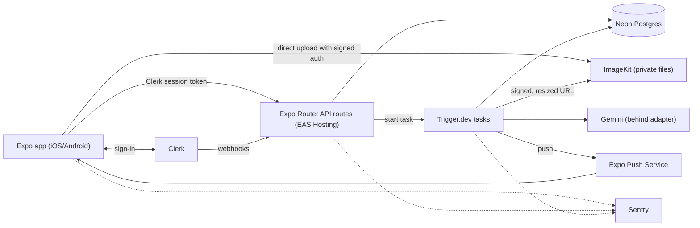

# AI Calorie Tracker: Spec & Discovery

> **Status:** Interview complete. Spec agreed and waiting for final sign-off. **No code or project setup yet.**
> Last updated: 2026-11-25

---

## 1. Product

**Problem:** Logging food by hand is tedious, so people give up. This app turns a photo (or a one-line description) into a per-item calorie and macro breakdown in seconds, and tracks it against a personal daily target.

**User:** An individual on iOS or Android who wants to **lose, maintain or gain** weight.

**Most important thing to get right:** fast, low-effort, *correctable* calorie and macro estimates from a photo.

**"Aha" moment:** The user takes a photo of a meal, puts the phone away, gets a "Your meal is ready: 640 kcal" notification, and sees today's calories-left ring update.

### In scope (v1)
- Onboarding before sign-in: sex, birth date/age, height, weight, activity level, goal (lose / maintain / gain), target weight, pace
- Daily calorie + macro targets calculated automatically (Mifflin-St Jeor), with user override
- Clerk sign-in with **Google + Apple**
- AI meal analysis from a **photo** or **free text**, run as a **Trigger.dev** background job, with a **push notification** when done
- Per-item review and editing (grams, add, remove); meals logged automatically with an "AI estimate · tap to review" badge
- Meal types (breakfast / lunch / dinner / snack), set by time of day and editable
- Home: calories-left ring, P/C/F bars, today's meals, camera button + "type it"
- History: daily view (date picker / swipe), edit or delete meals, kept forever
- Profile: edit body stats, goal, targets, units; sign out; **delete account**
- Metric / imperial switch
- Daily AI scan limit (default 15/day); manual entry still works when it's reached
- Light + dark mode (follows the phone's setting)
- Sentry across the app, API and background tasks

### Out of scope (v1)
- Payments or subscriptions (the schema allows for them later)
- Weight log, progress charts, weekly analytics
- Micronutrients (fibre, sugar, sodium, vitamins). **Calories + protein/carbs/fat only.**
- Streaks, water, steps, HealthKit / Google Fit
- Offline queue (internet required)
- Choosing an AI model in the app
- Product analytics (PostHog etc.)
- Web app, social features, barcode scanning, recipes
- Languages other than English

---

## 2. Core user journeys

### 2.1 First launch → onboarding → sign-in
1. **Welcome screen**: "Get started" + "Already have an account? Sign in" (the link skips onboarding).
2. **Onboarding steps:** goal → sex → birth date → height → current weight → target weight → pace (hidden for "maintain") → activity level → **targets preview** (kcal + P/C/F, editable).
3. Answers are saved **on the device** (AsyncStorage/SecureStore). Nothing is sent before sign-in.
4. **Sign-in screen**: Clerk with Google / Apple.
5. After sign-in: the app calls `POST /api/me/onboarding` with the saved answers → the server creates the user row if needed, saves the profile and targets → the device copy is cleared.
6. **Notification permission** is requested *after* onboarding, explained as "We'll tell you when your meal is analyzed."
7. → **Home**.

### 2.2 Returning user
Clerk session found → app gets `/api/me` → Home. If the profile is incomplete (e.g. the user tapped "Sign in" on a new phone without an account), they're sent to onboarding.

### 2.3 Photo scan (main loop)
1. Tap the camera → capture (or choose from gallery) → the photo is shrunk and compressed on the device.
2. The app requests **ImageKit upload auth** from the API → uploads **straight to ImageKit** (private folder `/users/{userId}/meals/`).
3. `POST /api/meals` `{ source: "photo", imageFileId, eatenAt, timezone, mealType?, idempotencyKey }`.
4. The API checks the **daily limit** (atomic counter), inserts a meal with `status = analyzing` and starts the Trigger.dev task `analyze-meal` (idempotency key = meal ID).
5. The app shows the meal on Home as **"Analyzing…"**. The user may leave.
6. **The task:**
   - creates a signed, resized ImageKit URL (~1024px JPEG)
   - downloads the image and calls the AI (structured JSON output)
   - checks the result with Zod
   - in one DB transaction: writes the items and totals, sets `status = completed`
   - sends an Expo push notification
7. Tapping the notification opens the meal detail through a deep link (`aical://meals/{id}`).
8. The user can review and edit items. The server recalculates totals and sets `user_edited = true`.

### 2.4 Text entry
Same as 2.3, but `source: "text"` with `textInput` ("2 eggs and a slice of toast") and no image.

### 2.5 Manual entry
Name + kcal + P/C/F (one item). Saved straight away as `completed`. **Doesn't count toward the AI limit.** This is also offered when the AI fails or the limit is reached.

### 2.6 Failure paths
| Case | Behaviour |
|---|---|
| AI timeout / 5xx / invalid JSON | Trigger.dev retries ×3 with a growing delay → `status = failed` + push "We couldn't analyze your meal" → meal shows **Retry** / **Enter manually** |
| Not food | AI returns `is_food: false` → failed entry deleted, push/in-app message "That doesn't look like food" |
| Low confidence | Saved normally; items marked `low` get a "Please check" badge |
| Daily limit reached | Camera/text button disabled with "Limit reached, resets at midnight" + manual entry offered |
| No internet | Clear error; the photo stays on the device; one-tap retry |
| Push permission denied | The app refetches when it comes back to the foreground and checks every ~5 s while a meal is `analyzing` and the screen is open |

### 2.7 Profile
Edit body stats, goal, pace, activity → targets recalculated (unless the user has set targets manually; then offer "Recalculate?"). Unit switch. Sign out. **Delete account** (confirmation → background deletion, see §5).

---

## 3. Data model (Neon Postgres, Drizzle ORM)

Weights, heights and grams are stored **in metric**. Timestamps are `timestamptz` (UTC).

```
users
  id                text PK          -- Clerk user ID
  email             text
  display_name      text
  unit_system       enum(metric, imperial)  default metric
  timezone          text             -- IANA timezone, updated by the app
  plan              enum(free)       default free   -- room for paid plans later
  created_at, updated_at

profiles                             -- 1:1 with users
  user_id           text PK FK→users (cascade)
  sex               enum(male, female)
  birth_date        date
  height_cm         numeric(5,1)     check 100–250
  weight_kg         numeric(5,1)     check 30–300
  target_weight_kg  numeric(5,1)     nullable
  goal              enum(lose, maintain, gain)
  pace_kg_per_week  numeric(3,2)     check 0–1  (0 for maintain)
  activity_level    enum(sedentary, light, moderate, active, very_active)
  onboarded_at      timestamptz
  updated_at

nutrition_targets                    -- 1:1 current targets
  user_id           text PK FK→users (cascade)
  calories          int
  protein_g, carbs_g, fat_g  int
  source            enum(auto, manual)
  updated_at

meals
  id                uuid PK
  user_id           text FK→users (cascade), indexed with local_date
  source            enum(photo, text, manual)
  status            enum(analyzing, completed, failed)
  meal_type         enum(breakfast, lunch, dinner, snack)
  eaten_at          timestamptz
  timezone          text
  local_date        date             -- set from eaten_at + timezone; used for daily queries
  image_file_id     text nullable    -- ImageKit fileId
  image_path        text nullable
  text_input        text nullable    (≤ 500 chars)
  title             text             -- AI-generated, e.g. "Chicken rice bowl"
  total_kcal        int              -- sum of items, recalculated on the server
  total_protein_g, total_carbs_g, total_fat_g  numeric(6,1)
  ai_model          text nullable
  trigger_run_id    text nullable
  error_code        text nullable
  user_edited       bool default false
  reviewed_at       timestamptz nullable
  idempotency_key   text UNIQUE (per user)
  created_at, updated_at

meal_items
  id                uuid PK
  meal_id           uuid FK→meals (cascade)
  position          int
  name              text
  grams             numeric(7,1)     check > 0
  kcal              int
  protein_g, carbs_g, fat_g  numeric(6,1)
  confidence        enum(low, medium, high) nullable
  origin            enum(ai, user)

push_tokens
  id                uuid PK
  user_id           text FK→users (cascade)
  expo_push_token   text UNIQUE
  platform          enum(ios, android)
  last_seen_at      timestamptz

ai_usage                             -- daily limit counter
  user_id           text FK→users (cascade)
  local_date        date
  scans             int
  PK (user_id, local_date)
```

**Relationships:** user 1–1 profile, 1–1 nutrition_targets, 1–N meals, 1–N push_tokens, 1–N ai_usage. Each meal has 1–N meal_items.

**Source of truth:** Neon for all app data. Clerk for identity. ImageKit for image files. The app caches data with TanStack Query and only keeps onboarding answers on the device before sign-in.

**Target formulas (v1):**
- Daily energy = Mifflin-St Jeor resting energy × activity multiplier (1.2 / 1.375 / 1.55 / 1.725 / 1.9).
- Goal adjustment = ± pace × 7700 kcal / 7, with a floor of 1200 kcal (female) / 1500 kcal (male).
- Protein 1.6 g/kg (lose and gain) or 1.4 g/kg (maintain); fat 25% of kcal; carbs = the rest.

---

## 4. Architecture



**One repo, TypeScript throughout:**
- `app/`: Expo Router screens + `app/api/*+api.ts` routes
- `src/shared`: Zod schemas, target calculations, unit conversion, Drizzle schema and client. Used by the app, the API and the tasks.
- `trigger/`: Trigger.dev tasks

**Business logic lives on the server:** target calculations (shared code, but the server is final), total recalculation, daily limit checks and AI calls. The app never holds AI, DB or ImageKit private keys.

### Service responsibilities
| Service | Responsible for |
|---|---|
| **Clerk** | Google + Apple sign-in, sessions, webhooks (`user.created/updated/deleted`) |
| **Expo Router API / EAS Hosting** | Checks the Clerk login, all DB reads/writes, ImageKit upload auth, starting tasks, webhook endpoints |
| **Neon** | All app data; separate branches for dev and prod |
| **Trigger.dev** | `analyze-meal` (retries, idempotency, failure hook), `send-push`, `delete-account` |
| **AI (Gemini, via adapter)** | Image/text → structured JSON: `is_food`, `title`, `items[] {name, grams, kcal, protein_g, carbs_g, fat_g, confidence}` |
| **ImageKit** | Private photo storage, resizing for the AI, thumbnails for the app via signed URLs |
| **Expo Push** | Delivering notifications. Push receipts are checked and invalid tokens removed. |
| **Sentry** | Errors and performance in the app, API and tasks. Releases tied to EAS builds and updates. |

### API endpoints (draft)
```
GET    /api/me                       profile + targets + today's usage
POST   /api/me/onboarding            save onboarding answers sent after sign-in
PATCH  /api/me/profile               edit stats/goal/units → recalculate targets
PUT    /api/me/targets               manual override / recalculate
DELETE /api/me                       start account deletion
POST   /api/push-tokens              register / refresh Expo push token
GET    /api/imagekit/auth            upload auth for ImageKit
POST   /api/meals                    create (photo | text | manual)
GET    /api/meals?date=YYYY-MM-DD    daily view
GET    /api/meals/:id                detail (+ signed image URL)
PATCH  /api/meals/:id                edit items / meal_type / eaten_at
POST   /api/meals/:id/retry          re-run a failed analysis
DELETE /api/meals/:id
POST   /api/webhooks/clerk           Svix-verified
```

### Background work rules
- **Idempotency:** `meals.idempotency_key` is unique, so creating the same meal twice from the app returns the same meal. The Trigger.dev idempotency key is the meal ID. Writing the result checks `status = analyzing` first, so a task running twice can't overwrite the user's edits.
- **Daily limit:** the counter in `ai_usage` goes up when a scan starts. **It goes back down if the analysis fails or the photo isn't food.**
- **Account deletion:** a Trigger.dev task deletes ImageKit files → DB rows (cascade) → Clerk user, with retries. Each step is safe to repeat.

---

## 5. Non-functional
- **Performance:** photo to result in under 20 s; Home loads in under 1 s from cache; images resized before upload (~1–2 MB maximum).
- **Scale:** small at first (hundreds to low thousands of users). Neon serverless and Trigger.dev cover this without changes.
- **Security:** every API route checks the Clerk session; all queries are filtered by `user_id`; secrets live only in EAS, Trigger and Neon environment variables; webhooks verified with Svix; images are private and only viewed through signed URLs.
- **Privacy:** in line with GDPR (see Assumptions). In-app account deletion. Privacy policy + "not medical advice" disclaimer.
- **Accessibility:** support system font scaling, screen-reader labels on main controls, enough colour contrast in both themes.
- **Internationalization:** English only. All strings kept in one place.

---

## 6. Environments & delivery
- **Environments:** **dev + prod.** Clerk, Trigger.dev and EAS each have dev and prod setups; Neon has a `main` (prod) branch and a `dev` branch, plus optional temporary branches for test builds.
- **CI (GitHub Actions):** type check, lint and tests on every PR.
- **Delivery:**
  - **EAS Build** (dev client, preview, production), **EAS Submit** to the stores, **EAS Update** for JS-only fixes
  - **EAS Hosting** for the API routes
  - **Trigger.dev CLI** deploy for tasks
  - **Drizzle** migrations run during the deploy step

## 7. Testing & definition of done
- **Unit:** target calculations, unit conversion, AI output check/normalization, total recalculation, meal-type-from-time.
- **Integration:** API routes against a Neon test branch (auth, filtering by user, daily limit, idempotency).
- **E2E:** **Maestro** flows for onboarding → sign-in (test account) → text entry → history → edit profile.
- **Manual checklist** on a real iPhone and Android phone: camera, push notifications, Apple/Google sign-in, deep links.
- **v1 is done when:** onboarding → sign-in → photo → push → review/edit → history → edit profile → delete account works on **both** platforms, and Sentry receives events from the app, API and tasks.

## 8. Tech stack
| Layer | Choice |
|---|---|
| App | React Native + **Expo (latest stable SDK, version checked at planning)**, Expo Router, development builds |
| Styling | **NativeWind**, light/dark following the phone's setting, minimal custom design (no Figma) |
| Server state | TanStack Query |
| Validation | Zod (shared) |
| API | Expo Router API routes on **EAS Hosting** |
| DB | **Neon** + **Drizzle ORM** + Neon serverless driver |
| Auth | **Clerk** (Google, Apple) |
| Jobs | **Trigger.dev** |
| AI | **Gemini** (Flash-class vision model) behind a provider adapter |
| Images | **ImageKit** |
| Push | expo-notifications + Expo Push Service |
| Monitoring | **Sentry** |
| CI/CD | GitHub Actions + EAS Build/Submit/Update |
| E2E | Maestro |

---

## 9. Assumptions (no firm answer given; change any of these)
- **A1:** AI provider = **Google Gemini** (Flash-class). Exact model ID confirmed against current docs during planning.
- **A2:** Push uses `expo-notifications` + Expo Push Service and requires an **EAS development build** (not Expo Go).
- **A3:** **English only** in v1.
- **A4:** Each day starts at midnight in the **user's timezone**; each meal stores its own timezone (travel doesn't move old meals to another day).
- **A5:** **GDPR-level privacy** baseline (in-app deletion, private photos, deletion when the account is deleted). No other compliance regime.
- **A6:** No weight log. Target weight + pace are **only used to calculate targets**. Weight is updated in Profile.
- **A7:** **No fixed AI budget.** Cost is controlled by resizing images before the AI call, the daily limit (15/day, set in config) and Sentry alerts.
- **A8:** **No launch deadline.** Solo developer.
- **A9:** You will have (or create) an **Apple Developer** account (\$99/yr) and a **Google Play Console** account (\$25). Both are needed for Apple Sign-In, push notifications and store release.
- **A10:** **TanStack Query + Zod** adopted (you picked 22A for the ORM; I've kept the rest of my recommendation).
- **A11:** No designs exist; I'll propose a **clean, minimal design** using NativeWind. Dark mode follows the phone's setting.
- **A12:** "24 ALL" = **Maestro E2E included** in v1.
- **A13:** Failed / not-food scans **don't count** toward the daily limit. Manual entries never count.
- **A14:** Store **birth date** (not age), so age stays correct over time.
- **A15:** Minimum user age **16+**, checked in onboarding (diet/weight apps and GDPR consent age).
- **A16:** Default macro split and calorie floors as listed in §3.
- **A17:** Photos can be taken with the camera **or** chosen from the gallery.

## 10. Open risks / unknowns
1. **AI accuracy:** estimating portion size from a photo is often ±20–30% off. That's why the per-item editing and confidence badges matter. Add a disclaimer and track how often users edit (later analytics).
2. **Health data under GDPR:** weight and diet data may count as *special category* health data (Art. 9) and need **explicit consent** during onboarding plus a privacy policy. Get a legal check before launch.
3. **EAS Hosting maturity:** check request timeouts, cold starts, regions, and support for Clerk webhooks and Drizzle/Neon in its runtime. Fallback: move the API to Hono on Vercel/Cloudflare with little change.
4. **Version drift:** Expo SDK, Clerk's Expo SDK, Trigger.dev, NativeWind and Drizzle versions move fast. NativeWind ↔ Expo SDK compatibility in particular must be checked against current docs before setup.
5. **Apple Sign-In + Clerk native setup:** needs an Apple Developer account, a Services ID and a key. It must work in TestFlight before review.
6. **Push reliability:** permission denials, invalid tokens, Android notification channels. Mitigation: in-app checking while a meal is analyzing, plus checking push receipts.
7. **AI cost / abuse:** without payments, the daily limit is the only control. Consider a global daily spending limit on the server (switch AI off when it's hit) if usage grows.
8. **Account deletion across 3 systems** (ImageKit, Neon, Clerk) can partly fail. This is handled with retries and steps that are safe to repeat, but it needs alerting.
9. **Solo-developer scope:** v1 is substantial (2 platforms, 7 services, E2E tests). The plan should be built in stages so a working loop exists early.
10. **App Store review:** needs in-app account deletion, Apple Sign-In alongside Google, a clear purpose string for camera/photo access, and health disclaimers.

---

## 11. Interview log (raw answers)
- **R1:** 1A (Expo API routes on EAS Hosting) · 2A (one provider + adapter) · 3C (push when done) · 4A (per-item edit) · 4b Yes (text/manual) · 5 Yes (full onboarding + auto targets + maintain) · 6 Yes (save on device → send after sign-in) · 6b A (macros only) · 6c Both platforms
- **R2:** 7A (auto-log + review badge) · 8A (text → AI) · 9a (meal types; no weight log/extras) · 10A (daily view, kept forever) · 11A (private photos kept) · 12 unit switch
- **R3:** 13A (free + daily limit) · 14A (block AI, allow manual) · 15 Agree (retry ×3, failed state, confidence) · 16A (online required) · 17 OK (Clerk ID PK + webhook + create on first request) · 18A (Sentry only)
- **R4:** 19 Solo developer · 20A (dev + prod) · 21 All (GitHub Actions + EAS Build/Submit/Update/Hosting) · 22A (Drizzle) · 23A All (NativeWind, minimal design, dark mode) · 24 All (testing bar + Maestro + DoD + latest stable Expo)
